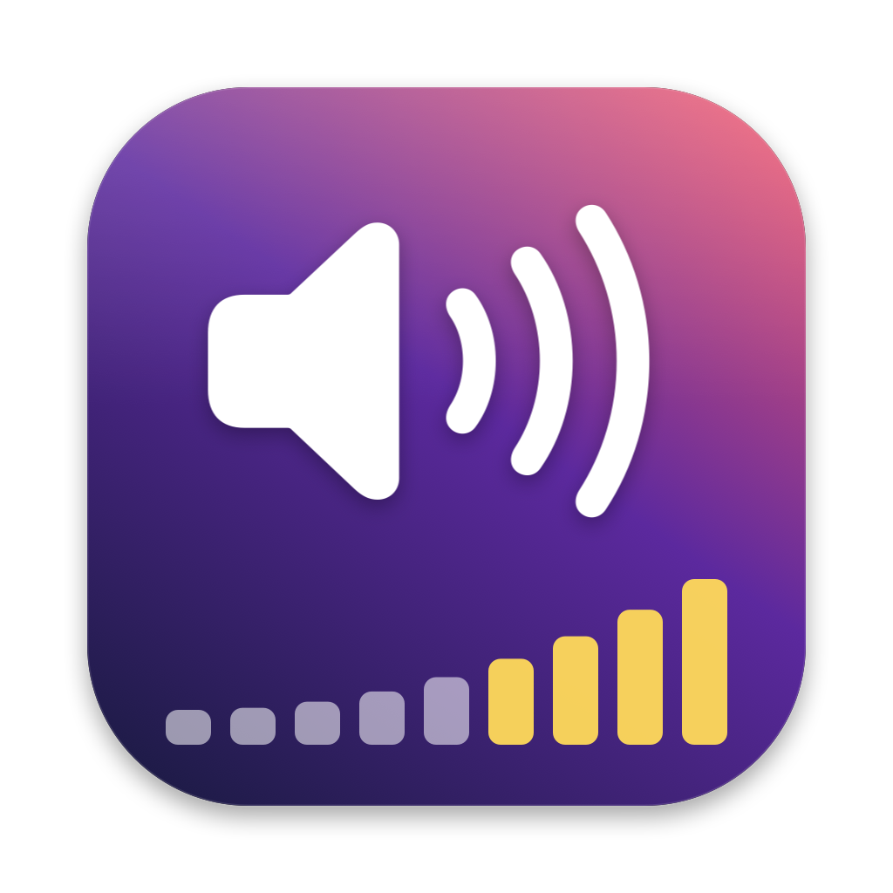
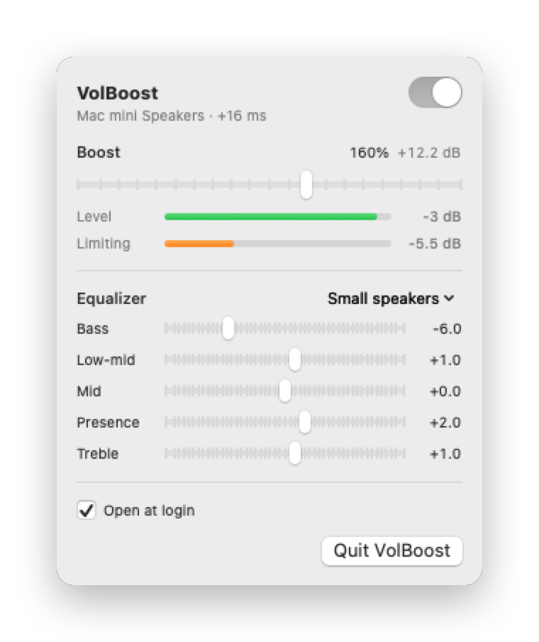

<p align="center">
  
</p>

<h1 align="center">VolBoost</h1>

<p align="center">Turn your whole Mac up past 100% — VLC-style volume boost for every app, from the menu bar.</p>

<p align="center">
  <picture>
    <source media="(prefers-color-scheme: dark)" srcset="docs/menu-dark.png">
    
  </picture>
</p>

VolBoost is a tiny menu bar app that boosts system-wide audio up to **200%**
(+18 dB), with a lookahead limiter so it gets louder without crackling, and a
small 5-band EQ to rebalance quiet or thin-sounding audio.

## Download

**[Download VolBoost.zip](https://github.com/max-pantom/volboost/releases/latest/download/VolBoost.zip)** — universal (Apple silicon + Intel), macOS 14.2+.

1. Unzip and drag **VolBoost.app** into Applications.
2. VolBoost isn't notarized yet, so macOS blocks the first launch: open
   **System Settings › Privacy & Security**, scroll down, click **Open Anyway**.
   (Or run `xattr -dr com.apple.quarantine /Applications/VolBoost.app`.)
3. Click the speaker in the menu bar and switch VolBoost on.

## Features

- **Boost 100–200%** using the same cubic volume curve as VLC
- **Clean at any setting** — a 5 ms lookahead peak limiter instead of clipping
- **5-band EQ** (Bass, Low-mid, Mid, Presence, Treble, ±12 dB) with presets,
  including one tuned for small built-in speakers
- **Live meters** for output level and how hard the limiter is working
- Follows the default output device when you switch or plug in headphones
- ~16 ms added latency, ~1–2% CPU
- Open at login, no Dock icon

## Requirements

- macOS 14.2 or later (uses Core Audio process taps)
- Swift 5.10+ — the Xcode Command Line Tools are enough to build

## Build and run

```sh
./build.sh
open VolBoost.app
```

`build.sh` produces a universal, ad-hoc signed `VolBoost.app`
(`ZIP=1 ./build.sh` also writes `VolBoost.zip`). Move it to
`/Applications` if you want to use *Open at login*.

The first time you switch VolBoost on, macOS asks for **System Audio
Recording** permission. VolBoost needs it to read the audio it boosts; nothing
is recorded or sent anywhere. You can change it later in
System Settings › Privacy & Security › Screen & System Audio Recording.

## How it works

VLC reaches 200% on macOS by setting `kHALOutputParam_Volume` on its own AUHAL
output unit to `volume³` with no upper clamp (so 200% = 8× linear gain). That
only affects audio VLC itself plays, so VolBoost applies the same idea to the
whole system:

```
apps ──► process tap on the default output device (originals muted while tapped)
     ──► private aggregate device
     ──► IOProc: EQ ─► gain (percent³) ─► lookahead limiter
     ──► default output device
```

- **Tap** — a `CATapDescription` scoped to the default output device's first
  stream, excluding VolBoost itself (otherwise it would hear its own output and
  feed back). Mute behaviour is `mutedWhenTapped`, so if VolBoost stops or
  crashes, normal audio returns immediately.
- **Limiter** — boosting mastered audio 8× pushes most peaks past full scale.
  Rather than clip or saturate them, the limiter computes the gain each frame
  needs, holds the minimum over a 5 ms window, smooths it with a moving average
  of the same length and applies it to audio delayed by 5 ms. This guarantees
  the −1 dBFS ceiling is never exceeded, with no waveform distortion.
- **EQ** — RBJ biquads (low shelf, three peaks, high shelf) ahead of the
  limiter, so EQ boosts are limited too.
- Everything on the IO thread is allocation- and lock-free; settings reach it
  through try-locks or single-word stores.

| Path | What |
| --- | --- |
| `Sources/VolBoost/BoostEngine.swift` | Core Audio tap, aggregate device, IOProc, device-change handling |
| `Sources/VolBoost/VolBoostApp.swift` | Menu bar UI and settings |
| `Sources/VolBoostDSP/Limiter.swift` | Gain + lookahead limiter |
| `Sources/VolBoostDSP/Equalizer.swift` | 5-band EQ and presets |
| `Sources/DSPCheck/main.swift` | Offline signal checks for the DSP |
| `Sources/VolBoost/Snapshot.swift` | Renders the README screenshots (`VolBoost.app/Contents/MacOS/VolBoost --snapshot docs`) |
| `Icon/` | App icon, drawn in code (`Icon/make-icon.sh` regenerates it) |

## Releasing

Push a version tag and the [release workflow](.github/workflows/release.yml)
builds a universal `VolBoost.zip` and publishes it as a GitHub release:

```sh
git tag v0.1.0 && git push origin v0.1.0
```

The website in `docs/` is served by GitHub Pages (Settings › Pages › Deploy
from branch `main`, folder `/docs`).

## Testing

```sh
swift run -c release DSPCheck
```

Feeds test signals through the limiter and EQ and checks the ceiling, harmonic
distortion and each band's response. It's an executable rather than a test
target so it also runs without full Xcode.

## Troubleshooting

VolBoost logs its setup, any restarts and a periodic health line:

```sh
/usr/bin/log show --last 10m --predicate 'subsystem == "local.volboost"'
```

If boosted audio is silent on some hardware, force the stereo global tap:

```sh
defaults write local.volboost tapMode global   # undo: defaults delete local.volboost tapMode
```

The global tap captures every app, including ones you routed to a different
output device.

## Limitations

- Heavily mastered music at 200% is limited constantly and can sound dense or
  pump; 150–170% is usually the sweet spot. Cutting Bass frees a lot of headroom.
- Small speakers can distort physically at high system volume even though the
  signal is clean.
- Devices with more than 8 channels fall back to a stereo mix.

## License

[MIT](LICENSE). VolBoost is not affiliated with VideoLAN or VLC; it reimplements
the idea of VLC's volume curve and contains no VLC code.
